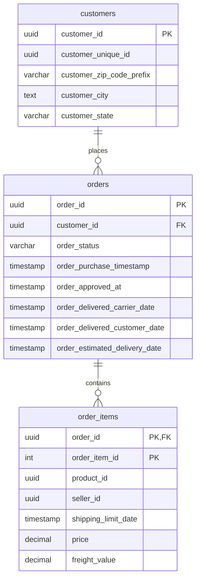

# CSV ETL Pipeline

A Python pipeline for cleaning three Olist CSV datasets: `orders`, `order_items`, and `customers`. It reads the source files, separates valid and rejected rows, and writes both results as CSV. PostgreSQL table definitions are provided, but loading data into PostgreSQL is not implemented yet.

## Data model

The ER diagram below reflects the keys and columns in `sql/schma.sql`:



## Project layout

```text
csv-etl-pipeline/
├── data/
│   ├── raw/                  # Source CSV files
│   ├── clean/                # Valid rows generated by the pipeline
│   └── rejected/             # Invalid rows and rejection reasons
├── logs/
│   ├── pipeline/             # Pipeline logs by dataset
│   └── profiling/            # Profiling logs by dataset
├── sql/
│   └── schma.sql             # PostgreSQL table definitions (existing filename)
├── src/
│   ├── Configuration.py      # Dataset paths and validation settings
│   ├── extract.py            # Read CSV files
│   ├── transform.py          # Normalize, validate, and split rows
│   ├── pipeline.py           # Run the three-dataset CSV pipeline
│   ├── profiling.py          # Log data profiling reports
│   ├── logger.py             # Configure file and console logging
│   └── load.py               # Placeholder; database loading is not implemented
├── tests/
│   └── test_transform.py     # Currently empty
└── requirements.txt
```

## Setup

Run commands from the project root. Use a Python version compatible with the pinned requirements. On Windows PowerShell:

```powershell
python -m venv .venv
.\.venv\Scripts\python.exe -m pip install -r requirements.txt
```

On macOS or Linux:

```bash
python3 -m venv .venv
.venv/bin/python -m pip install -r requirements.txt
```

The required source files are `data/raw/olist_orders_dataset.csv`, `data/raw/olist_order_items_dataset.csv`, and `data/raw/olist_customers_dataset.csv`. Other Olist CSV files may be present but are not processed by this pipeline.

## Run the pipeline

From the project root, with the virtual environment active:

```bash
python -m src.pipeline
```

The pipeline processes `orders`, `order_items`, and `customers`. For each dataset it creates:

```text
data/clean/olist_<dataset>_clean.csv
data/rejected/olist_<dataset>_rejected.csv
```

Every rejected row includes `rejection_reason`; it may contain several reasons separated by semicolons. Rejected rows also retain raw date or numeric values in `raw_...` columns for inspection. The pipeline checks that clean plus rejected row counts equal the input count. It writes logs to `logs/pipeline/<dataset>.log` and the console. Running the pipeline again replaces the generated CSV files.

Customer ZIP code prefixes are read as strings to preserve leading zeros. If you inspect a generated customer CSV with pandas, specify the type again because `read_csv()` infers types on each read:

```python
pd.read_csv(
    "data/clean/olist_customers_clean.csv",
    dtype={"customer_zip_code_prefix": "string"},
)
```

## Profile source data

```bash
python -m src.profiling
```

Profiling logs row counts, duplicates, memory use, and per-column statistics for the same three source datasets. It also reports order-status counts for `orders`. Reports go to the console and `logs/profiling/<dataset>.log`. Profiling does not create clean CSV files.

## PostgreSQL schema

`sql/schma.sql` defines the `customers`, `orders`, and `order_items` tables. ID columns use PostgreSQL `UUID`; `order_item_id` is an integer within an order. The source IDs are 32 hexadecimal characters, which PostgreSQL accepts as UUID input. The order item primary key is `(order_id, order_item_id)`.

The tables have foreign keys, so database loading must happen in this order: `customers`, then `orders`, then `order_items`. `CREATE TABLE IF NOT EXISTS` creates missing tables but does not migrate existing ones. The pipeline currently writes CSV only; it does not run this SQL or load rows into PostgreSQL.

## Tests and current limitations

`tests/test_transform.py` is currently empty, so there is no committed automated test suite yet. `src/load.py` is also empty. The `requirements.txt` file includes PostgreSQL libraries for future loading work, but the current pipeline does not use them.

