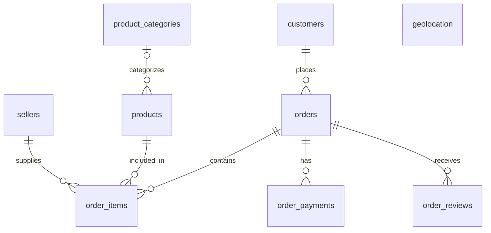

# CSV ETL Pipeline ER Diagram

[Back to README](../README.md)

Based on [sql/schma.sql](../sql/schma.sql).

## Diagram



Geolocation has no foreign key relationship to customers or sellers. A ZIP may
identify multiple geographic rows. A product may have no category.

## Table definitions

### `customers`

Stores customer identifiers and address information.

| Column | Type | Key | Nullable | Default | Description |
| --- | --- | --- | --- | --- | --- |
| `customer_id` | uuid | PK | No | — | Unique identifier of the customer |
| `customer_unique_id` | uuid | — | No | — | Identifier grouping records for the same customer |
| `customer_zip_code_prefix` | varchar(5) | — | No | — | Customer ZIP prefix, preserving leading zeroes |
| `customer_city` | text | — | No | — | Customer city |
| `customer_state` | varchar(2) | — | No | — | Customer state abbreviation |

### `sellers`

Stores seller identifiers and original ZIP, city, and state values.

| Column | Type | Key | Nullable | Default | Description |
| --- | --- | --- | --- | --- | --- |
| `seller_id` | uuid | PK | No | — | Unique identifier of the seller |
| `seller_zip_code_prefix` | varchar(5) | — | No | — | Seller ZIP prefix, preserving leading zeroes |
| `seller_city` | text | — | No | — | Seller city |
| `seller_state` | varchar(2) | — | No | — | Seller state abbreviation |

### `orders`

Stores customer orders, statuses, and order lifecycle timestamps.

| Column | Type | Key | Nullable | Default | Description |
| --- | --- | --- | --- | --- | --- |
| `order_id` | uuid | PK | No | — | Unique identifier of the order |
| `customer_id` | uuid | FK → `customers.customer_id` | No | — | Customer associated with this record |
| `order_status` | varchar(20) | — | No | — | Current order status |
| `order_purchase_timestamp` | timestamp | — | No | — | Date and time of purchase |
| `order_approved_at` | timestamp | — | Yes | — | Date and time of payment approval |
| `order_delivered_carrier_date` | timestamp | — | Yes | — | Date and time handed to the carrier |
| `order_delivered_customer_date` | timestamp | — | Yes | — | Date and time delivered to the customer |
| `order_estimated_delivery_date` | timestamp | — | Yes | — | Estimated delivery date |

Allowed statuses: `created`, `approved`, `invoiced`, `processing`, `shipped`,
`delivered`, `canceled`, `unavailable`.

### `order_items`

Stores products and sellers associated with each order item.

| Column | Type | Key | Nullable | Default | Description |
| --- | --- | --- | --- | --- | --- |
| `order_id` | uuid | PK, FK → `orders.order_id` | No | — | Unique identifier of the order |
| `order_item_id` | integer | PK | No | — | Item sequence within the order; must be greater than zero |
| `product_id` | uuid | FK → `products.product_id` | No | — | Product associated with this record |
| `seller_id` | uuid | FK → `sellers.seller_id` | No | — | Seller associated with this record |
| `shipping_limit_date` | timestamp | — | No | — | Shipping deadline |
| `price` | numeric(12, 2) | — | No | — | Item price; must be nonnegative |
| `freight_value` | numeric(12, 2) | — | No | — | Freight charge; must be nonnegative |

Columns marked PK form a composite primary key.

### `order_payments`

Stores payment methods, installment counts, and amounts for orders.

| Column | Type | Key | Nullable | Default | Description |
| --- | --- | --- | --- | --- | --- |
| `order_payments_id` | uuid | PK | No | `gen_random_uuid()` | Unique payment identifier; pipeline supplies a stable UUID v5 |
| `order_id` | uuid | FK → `orders.order_id`, Composite UK | No | — | Order associated with this record |
| `payment_sequential` | integer | Composite UK | No | — | Payment sequence within the order; must be greater than zero |
| `payment_type` | varchar(20) | — | No | — | Allowed payment method |
| `payment_installments` | integer | — | No | — | Nonnegative installment count; zero is allowed |
| `payment_value` | numeric(12, 2) | — | No | — | Nonnegative payment amount |

`order_id` and `payment_sequential` together form one unique constraint.
Allowed payment types: `credit_card`, `boleto`, `voucher`, `debit_card`, `not_defined`.

### `order_reviews`

Stores review scores and optional customer comments for orders.

| Column | Type | Key | Nullable | Default | Description |
| --- | --- | --- | --- | --- | --- |
| `order_review_id` | uuid | PK | No | — | Source review ID, renamed from review_id during cleaning |
| `order_id` | uuid | PK, FK → `orders.order_id` | No | — | Unique identifier of the order |
| `review_score` | integer | — | No | — | Integer rating from 1 to 5 |
| `review_comment_title` | text | — | Yes | — | Optional review title |
| `review_comment_message` | text | — | Yes | — | Optional review message |
| `review_creation_date` | timestamp | — | No | — | Review creation date |
| `review_answer_timestamp` | timestamp | — | No | — | Date and time the review was answered |

Columns marked PK form a composite primary key.

### `product_categories`

Stores canonical category names, optional English names, and integer category IDs.

| Column | Type | Key | Nullable | Default | Description |
| --- | --- | --- | --- | --- | --- |
| `product_category_id` | integer | PK | No | Identity (BY DEFAULT) | Unique identifier of the category |
| `product_category_name` | text | UK | No | — | Canonical product category name |
| `product_category_name_english` | text | — | Yes | — | English category name, when available |

### `products`

Stores product categories, descriptive measurements, and physical dimensions.

| Column | Type | Key | Nullable | Default | Description |
| --- | --- | --- | --- | --- | --- |
| `product_id` | uuid | PK | No | — | Unique identifier of the product |
| `product_category_id` | integer | FK → `product_categories.product_category_id` | Yes | — | Category associated with this record |
| `product_name_lenght` | integer | — | Yes | — | Length of the product name; source spelling retained |
| `product_description_lenght` | integer | — | Yes | — | Length of the product description; source spelling retained |
| `product_photos_qty` | integer | — | Yes | — | Number of product photos |
| `product_weight_g` | numeric(12, 2) | — | Yes | — | Product weight in grams |
| `product_length_cm` | numeric(12, 2) | — | Yes | — | Product length in centimeters |
| `product_height_cm` | numeric(12, 2) | — | Yes | — | Product height in centimeters |
| `product_width_cm` | numeric(12, 2) | — | Yes | — | Product width in centimeters |

### `geolocation`

Stores geographic coordinates and address labels; multiple rows may share a ZIP.

| Column | Type | Key | Nullable | Default | Description |
| --- | --- | --- | --- | --- | --- |
| `geolocation_id` | integer | PK | No | — | Location identifier assigned by validation in file row order |
| `zip_code` | varchar(5) | — | No | — | ZIP prefix as text, preserving leading zeroes |
| `geolocation_lat` | double precision | — | No | — | Latitude |
| `geolocation_lng` | double precision | — | No | — | Longitude |
| `geolocation_city` | text | — | No | — | City label |
| `geolocation_state` | varchar(2) | — | No | — | State abbreviation |

## Indexes and unique constraints

| Table | Columns | Type |
| --- | --- | --- |
| `customers` | `customer_id` | Primary key |
| `sellers` | `seller_id` | Primary key |
| `orders` | `order_id` | Primary key |
| `order_items` | `order_id`, `order_item_id` | Primary key |
| `order_payments` | `order_payments_id` | Primary key |
| `order_reviews` | `order_review_id`, `order_id` | Primary key |
| `product_categories` | `product_category_id` | Primary key |
| `products` | `product_id` | Primary key |
| `geolocation` | `geolocation_id` | Primary key |
| `product_categories` | `product_category_name` | Unique constraint |
| `order_payments` | `order_id`, `payment_sequential` | Unique constraint |
| `geolocation` | `zip_code` | Index |
| `order_reviews` | `order_id` | Index |
| `orders` | `customer_id` | Index |
| `order_items` | `product_id` | Index |
| `order_items` | `seller_id` | Index |
| `customers` | `customer_unique_id` | Index |
| `products` | `product_category_id` | Index |

## Pipeline load order

The current [pipeline](../src/pipeline.py) loads:

```text
customers -> sellers -> orders -> order_payments -> order_reviews
          -> product_categories -> products -> geolocation -> order_items
```

Order items are cleaned earlier but retained until all their parent tables load.
Products, categories, and geolocation load from `data/validate/`; other tables
load clean DataFrames. With `dev_mode = True`, no tables are created or loaded.

## Existing database upgrades

The schema explicitly changes category identity generation, renames the old
reviews column, and adds missing order-item product/seller foreign keys.
Other create-table changes do not automatically migrate an existing table.
In particular, older payment tables need a separate migration for the UUID
primary key, unique payment key, and payment-type check.
