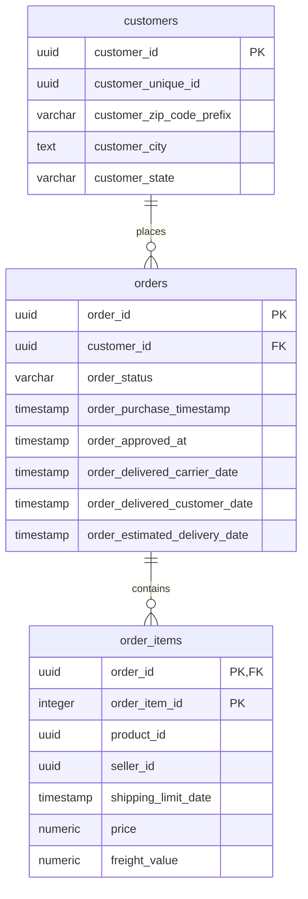

# ER Diagram

[Back to README](../README.md)

The diagram reflects the PostgreSQL tables, keys, and relationships defined in
`sql/schma.sql`.



## Keys and relationships

- `customers.customer_id` is the customer primary key.
- `orders.order_id` is the order primary key.
- `orders.customer_id` references `customers.customer_id`.
- `order_items` uses the composite primary key
  (`order_id`, `order_item_id`).
- `order_items.order_id` references `orders.order_id`.

## Required load order

The foreign keys require this load order:

1. `customers`
2. `orders`
3. `order_items`

`src/pipeline.py` must therefore define:

```python
DATA_LIST = ("customers", "orders", "order_items")
```
